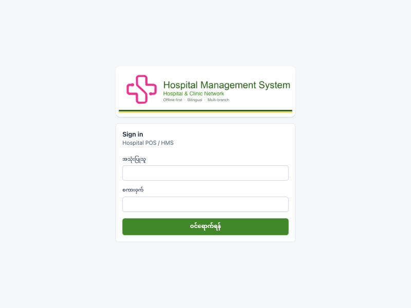
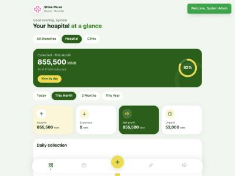
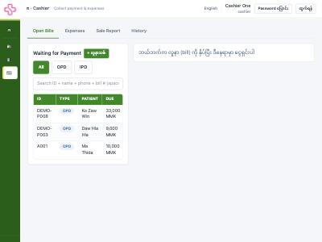
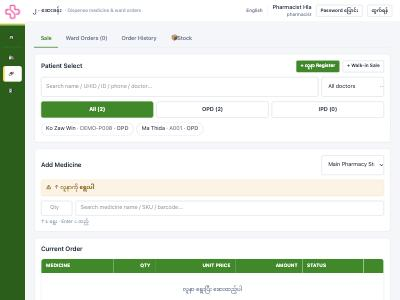

# ဆေးရုံ စီမံခန့်ခွဲမှု စနစ်

> [🇬🇧 English](README.md) &nbsp;|&nbsp; 🇲🇲 မြန်မာ

> **Copyright (c) 2026 Luxx Digital Solution. All Rights Reserved.**
> ခွင့်မပြုဘဲ ကူးယူခြင်း၊ ဖြန့်ဝေခြင်း သို့မဟုတ် အသုံးပြုခြင်းကို တင်းကြပ်စွာ တားမြစ်သည်။

မြန်မာနိုင်ငံရှိ ဆေးရုံတစ်ခုနှင့် ၎င်း၏ ကျောင်းဆေးခန်းအတွက် တည်ဆောက်ထားသော ဆေးရုံ စီမံခန့်ခွဲမှု စနစ် ပြည့်စုံသည်။
လူနာ မှတ်ပုံတင်ခြင်းမှ ဆေးခန်း၊ ဓာတ်ခွဲခန်း၊ X-Ray၊ IPD ဆောင်၊ ငွေကောက်ကောင်တာနှင့် ပိုင်ရှင်၏ နေ့စဉ် ငွေစာရင်းအစီရင်ခံစာအထိ ကောင်တာတိုင်းကို ပြေးဆွဲပေးသည်။
Internet ချိတ်ဆက်မှု ပြတ်သွားသော်လည်း ဆက်လက်အလုပ်လုပ်သည်။

စနစ်သည် **နေ့စဉ် ထုတ်လုပ်မှုတွင် အသုံးပြုနေပြီး**: ဆေးခန်းတစ်ခုတည်းက တစ်ရက်လျှင် လုပ်ဆောင်ချက် ၁,၅၀၀–၃,၅၀၀ ကြိမ် မှတ်တမ်းတင်သည်။

> UI သည် မြန်မာ / English နှစ်ဘာသာ ဖြစ်ပြီး အသုံးပြုသူတစ်ဦးစီ ပြောင်းလဲနိုင်သည်။

---

## Screenshots

| Login | ပိုင်ရှင် Dashboard |
|---|---|
|  |  |

| ငွေကောက်ကောင်တာ | ဆေးခန်း |
|---|---|
|  |  |

---

## ထူးခြားချက်များ

### 🔌 Offline-first, Cloud-Hybrid — ဆေးရုံနှစ်ခုကို တစ်စနစ်တည်းနဲ့

ဆေးရုံနှင့် ဆေးခန်း တစ်ခုစီသည် မိမိ Local LAN ပေါ်တွင် FastAPI + SQLite server လွတ်လပ်စွာ run သည်။
Internet ပြတ်ကျသွားသောအခါ ကောင်တာများ ပုံမှန်အတိုင်း ဆက်လက်အလုပ်လုပ်သည် — Error မပေါ်ဘူး၊ Data ပျောက်ဘူး။
Internet ပြန်ရသောအခါ 15 စက္ကန့်တစ်ကြိမ် Cloud ကို auto-sync လုပ်ပြီး ဆေးဖိုး Catalog ဆွဲချသည်။
လူကိုယ်တိုင် ဘာမှ မလုပ်ရ။

```
Internet ပြတ် →  ကောင်တာများ Local LAN ကနေ ဆက်အလုပ်လုပ်သည်
Internet ရ    →  Cloud ကို auto-sync၊ ဆေးဖိုး Catalog ဆွဲချသည်
```

Cloud server သည် ဆေးရုံနှစ်ခုလုံး၏ မိတ္တူကို real-time ထိန်းသိမ်းထားသောကြောင့် ပိုင်ရှင်သည် ကမ္ဘာ့မည်သည့်နေရာကမဆို ကြည့်ရှုနိုင်သည်။

### 📱 QR Live-Queue — Offline နှင့် ပြင်ပမှပါ အလုပ်လုပ်သည်

OPD လူနာတိုင်း QR Code ပါသော ဘောင်ချာ ရသည်။ QR scan ဖတ်ရင် **"သင့်ရှေ့မှာ X ယောက်ရှိသည်"** ဟု ပြသည့် public page ဖွင့်သည် (login မလို)။
Queue board ကို ဆောင့်ခန်းရှိ TV မျက်နှာပြင်တွင်လည်း WebSocket မှတဆင့် live ပြသည်။

**ပညာရည်ရှိသောအပိုင်း**: QR link သည် Cloud ကို ညွှန်ပြသောကြောင့်—
ဆေးရုံ LAN ထဲတွင် → Local server မှ ချက်ချင်းဖြေကြားသည်
ဆေးရုံပြင်ပ / 4G မှ → Cloud က Site မှ ဆွဲယူပြီး Proxy ဆင်းပေးသည်
ဆောင့်ခန်း TV → WebSocket မှတဆင့် live update၊ Refresh မလို

```
ဆေးရုံ LAN ထဲ   →  Local server မှ တုံ့ပြန်သည်
ပြင်ပ / 4G မှ    →  Cloud က Site မှ Proxy ဆင်းပေးသည်
ဆောင့်ခန်း TV    →  WebSocket live board
```

### 🔄 Remote OTA Software Update — On-site ကိုသွားစရာမလို

ပိုင်ရှင်သည် Cloud မှ Build အသစ် တင်ရုံနှင့် ဆုံးသည်။
Site တစ်ခုစီ၏ Windows Service သည် နောက်ကွယ်တွင် ဆိုင်းငံ့ Download လုပ်ပြီး Database Backup ပြုလုပ်ကာ Update ကို Apply ကာ ကိုယ်ဟာကိုယ် Restart လုပ်သည်။
Version အသစ် Start မအောင်ပါက အလိုအလျောက် Rollback ပြန်လုပ်သည်။

```
ပိုင်ရှင် Build တင်  →  Site များ Background တွင် Download လုပ်သည်
နောက်ပိုင်း Start မှ →  DB Backup → Apply → Restart
                      →  Fail ဖြစ်ပါက Auto Rollback
```

### 🕛 Midnight Auto Book Cut-off

Cashier မပါဘဲ ည ၁၂ နာရီတွင် နေ့စဉ် စာရင်းများ အလိုအလျောက် ပိတ်သည်။
PC ပိတ်ထားခဲ့ပါက ပြန်ဖွင့်သောအခါ ပျောက်ကွက်သော Midnight များကို Catch-up လုပ်သည်။
Shift Float ကို မှန်ကန်စွာ ဆက်သွယ်ပေးသည်။

### 👁 ဆေးရုံနှစ်ခုလုံးကို ကြည့်ရှုနိုင်သော ပိုင်ရှင် Panel

ဆေးရုံနှင့် ဆေးခန်းနှစ်ခုလုံး၏ ဝင်ငွေ၊ Stock၊ Activity Log နှင့် HR ကို Dashboard တစ်ခုတည်းတွင် ကြည့်ရှုနိုင်သည်။
Internet ရှိသည့် မည်သည့်နေရာကမဆို ကြည့်ရှုနိုင်ပြီး Staff တစ်ဦးစီသည် မိမိကောင်တာ၏ Data ကိုသာ မြင်နိုင်သည်။

---

## Features

**လူနာ & Queue**
- UHID ပါသော လူနာ မှတ်ပုံတင်ခြင်း၊ အမည်/ဖုန်းနံပါတ် ထပ်နေပါက သတိပေးသည်
- OPD Queue Token နှင့် "သင့်ရှေ့မှာ X ယောက်" public page (QR Code)
- OPD → IPD ပြောင်းခြင်း၊ IPD တက်နေသော လူနာကို OPD Bill ထပ်ဖွင့်၍မရ

**ကောင်တာများ** (Role တစ်ခုစီ မိမိကောင်တာကိုသာ မြင်သည်)
- **Cashier** — Bill ဖွင့်ခြင်း၊ ငွေပေးချေမှု ခွဲခြမ်းခြင်း (Cash / KPay / Wave / Card)၊ Deposit၊ Discount၊ Item လဲလှယ်/ပြန်ပေးခြင်း၊ Void/Delete (Stock နှင့် Ledger ပြန်ဖြည့်)၊ Pay-later Credit Bill
- **ဆေးခန်း** — FIFO Batch မှ ဆေးထုတ်ပေးခြင်း၊ ပြင်ပလူနာ ဆေးရောင်းခြင်း၊ ဆောင်အမိန့်၊ ပြန်အမ်းခြင်း၊ လူနာ၏ ယခင် ဆေးများ One-click ပြန်မှာနိုင်ခြင်း
- **ဓာတ်ခွဲခန်း (Lab)** — Order ဖွင့်ခြင်း၊ ရလဒ်ထည့်ခြင်း၊ **Report Template ပြန်သုံးနိုင်သည်**
  (Test တစ်ခု၏ Format ကို တစ်ကြိမ်သာ သတ်မှတ်ပါ — နောက်ပိုင်း Order တိုင်း အလိုအလျောက် ဖြည့်ပေးသည်)၊
  Reference Range ပါသော **LABORATORY REPORT** Print ထုတ်ခြင်း
- **X-Ray / Radiology** — Order၊ ရောဂါသတ်မှတ်ချက် ထည့်ခြင်း၊ Letterhead + လူနာအချက်အလက် + ဆရာဝန် လက်မှတ်နေရာ ပါသော **RADIOLOGY REPORT** Print ထုတ်ခြင်း
- **USG** — X-Ray နှင့် တူညီသော Workflow၊ သီးခြား Counter နှင့် Report Format
- **IPD** — တက်ရောက်ခြင်း၊ အိပ်ခန်းသတ်မှတ်ခြင်း၊ နေ့စဉ် ห้องcost၊ Deposit၊ ဆင်းခွင့်ပြုခြင်း
- **OT** — ခွဲစိတ်ခ၊ OT Item နှင့် Staff

**ငွေ & စာရင်းကိုင်**
- Shift/Cash Drawer ပိတ်ခြင်း၊ Float ကို ရှေ့ Shift သို့ ဆက်သွယ်ပေးသည်
- ည ၁၂ နာရီ Auto Cut-off (PC ပိတ်ထားရင်တောင် Catch-up)
- Sale Report၊ ဆရာဝန် ကြေးစာရင်း၊ ကုန်ကျစရိတ်စာအုပ်
- Activity Log — Action တိုင်း လူနာနှင့် Bill နဲ့ ချိတ်ဆက်ထားသည်

**Inventory**
- ဗဟိုဂိုဒေါင် + ကောင်တာ Store၊ Batch & Expiry၊ Negative Stock သတိပေးချက်
- Item Master ကို Cloud မှ Sync ဆွဲချသည်

**Admin & ပိုင်ရှင်**
- Role 17 ခု၊ Feature တစ်ခုစီ ခွင့်ပြုချက် (RBAC) နှင့် Branch Scoping
- ဆေးရုံနှစ်ခုလုံး ကြည့်ရှုနိုင်သော ပိုင်ရှင် Panel၊ Analytics၊ HR
- Receipt / Voucher / Report Print (Myanmar စာလုံး ပြသမှုနှင့်အတူ PDF)

---

## Architecture

```
                 ┌────────────────────────────┐
                 │  Cloud (FastAPI + SQLite)   │  Item Master၊ ပိုင်ရှင် Panel၊
                 │  Caddy နောက်တွင်            │  Site နှစ်ခု၏ Read-only မိတ္တူ
                 └──────────▲─────────────────┘
                            │  15 စက္ကန့်တစ်ကြိမ် Sync
          ┌─────────────────┴─────────────────┐
┌─────────┴─────────┐               ┌─────────┴─────────┐
│ ဆေးရုံ LAN PC     │               │ ဆေးခန်း LAN PC    │
│ Windows Service   │               │ Windows Service   │
│ FastAPI + SQLite  │               │ FastAPI + SQLite  │
└─────────▲─────────┘               └─────────▲─────────┘
          │ LAN ရှိ Browser များ              │
   ကောင်တာများ (Cashier, ဆေးခန်း, Lab …)   ကောင်တာများ
```

- **Backend:** Python 3.12, FastAPI, SQLAlchemy 2, Pydantic 2, SQLite (WAL)
- **Frontend:** React SPA, Prebuilt Bundle (`frontend/dist/`)
- **Windows Installer:** `windows/` — Embedded Python ပါသော Self-contained ZIP၊ Background Service အဖြစ် Install လုပ်သည်

---

## Local Run ပြုလုပ်နည်း

Python 3.12 လိုအပ်သည်။

```bash
cd backend
python3.12 -m venv venv
venv/bin/pip install -r requirements.txt
cd ..
backend/venv/bin/python run_local.py
```

<http://localhost:8002> ကိုဖွင့်ပါ။ ပထမဆုံး Run မှ Demo Data ပါသော Database ဖန်တီးသည်။

| Username | Role | Password |
|---|---|---|
| `admin1` | Branch 1 Admin | `ChangeMe@123` |
| `admin` | Hospital Owner | `ChangeMe@123` |
| `cashier` | Cashier | `ChangeMe@123` |

(`backend/app/db/seed.py` တွင် Demo Account အားလုံး ကြည့်နိုင်သည်။ အသုံးပြုမည်ဆိုပါက Password များ ပြောင်းလဲပါ။)

---

## မှတ်ချက်

- Frontend ကို **Prebuilt Bundle** (`frontend/dist`) အနေဖြင့် ထည့်သွင်းထားသည်။
- AI Coding Assistant ၏ အကူအညီဖြင့် တည်ဆောက်ထားသည်။
