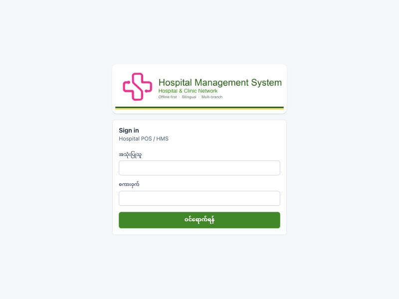
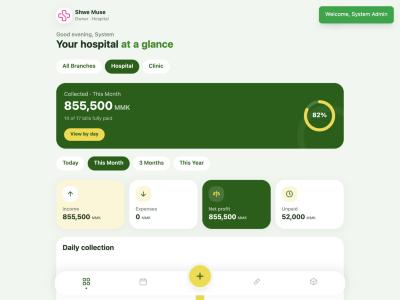
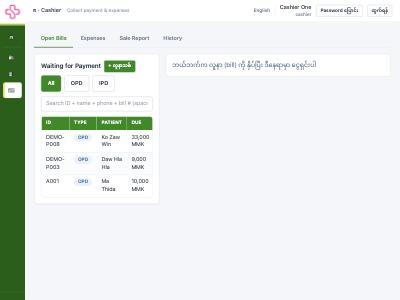
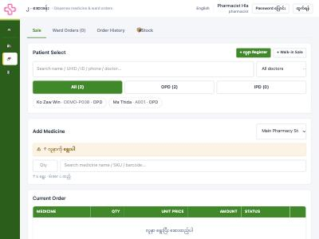

# Hospital Management System

> **Copyright (c) 2026 Luxx Digital Solution. All Rights Reserved.**
> Unauthorized copying, distribution, or use of this software is strictly prohibited.

A full hospital and clinic management system built for a private hospital and
its satellite clinic in Myanmar. It runs every counter of the hospital — from
patient registration to the pharmacy, lab, X-ray, inpatient wards, cashier and
the owner's daily money report — and keeps working when the internet is down.

The system is **in daily production use**: the clinic alone records roughly
1,500–3,500 actions a day across reception, cashier, pharmacy and lab staff.

> UI is bilingual (Myanmar / English) and switchable per user.

---

## What makes this different

### 🔌 Offline-first, cloud-hybrid — two hospitals, one system
The hospital and clinic each run a fully independent FastAPI + SQLite server on
their local LAN. Staff keep working normally when the internet drops — no
spinners, no errors, no data loss. When connectivity returns the site
automatically syncs to the cloud (every 15 s) and pulls the latest drug prices
and catalog. No manual intervention ever needed.

```
Internet down  →  every counter still works, data saved locally
Internet up    →  auto-sync to cloud, item master pulled down
```

The cloud server keeps a live read-only mirror of both sites, so the owner can
watch both branches in real time from any device anywhere.

### 📱 QR live-queue — works offline AND from outside
Every OPD visit prints a receipt with a QR code. Scanning it opens a public
page (no login) showing **"X patients ahead of you"**, updated live via
WebSocket. The queue board also runs on the waiting-room TV display.

The clever part: the QR link points to the **cloud**. If a patient steps
outside the hospital's LAN, their phone still reaches the cloud endpoint, which
fetches the ticket status from the site — so the queue page works from anywhere,
even on mobile data, without exposing the internal server.

```
Inside hospital LAN  →  local server answers instantly
Outside / on 4G      →  cloud proxies the request to the site
Waiting-room TV      →  live board updates via WebSocket, no refresh needed
```

### 🔄 Remote OTA software update — no on-site visits
The owner pushes a new build from the cloud. Each site's Windows service
downloads it silently in the background, backs up the database, applies the
update, and restarts — all without anyone touching the PC. If the new version
fails to start, it rolls back automatically.

```
Owner releases build  →  sites download in background
On next startup       →  DB backup → apply → restart
                      →  if startup fails → automatic rollback
```

### 🕛 Automatic midnight book cut-off
Every night at midnight the system closes the day's books automatically — even
if no cashier is logged in. If the PC was off, it catches up all missed
midnights on next start. Float from the last shift carries forward correctly.

### 👁 Owner panel across both branches
Revenue, stock, activity log and HR for both the hospital and the clinic in one
dashboard — visible from anywhere with internet, while each branch's staff see
only their own counter.

---

## Screenshots

| Login | Owner Dashboard |
|---|---|
|  |  |

| Cashier Counter | Pharmacy |
|---|---|
|  |  |

---

## Features

**Patients & queue**
- Patient registration with UHID, duplicate-name/phone warning, edit history
- OPD queue tokens with a public "patients ahead of you" page (QR code)
- OPD → IPD conversion; an admitted patient cannot be given a second OPD bill

**Counters** (each role sees only its own counter)
- **Cashier** — open bills, split payments (cash / KPay / Wave / card), deposits,
  discounts, item exchange & return, void / un-void / delete with full stock and
  ledger reversal, credit (pay-later) bills with a monthly credit book
- **Pharmacy** — dispense from stock with FIFO batches, walk-in sales, ward
  orders, returns, searchable dispense history grouped by bill, a patient's
  previous medicines with one-click re-order
- **Lab / X-ray / USG** — orders, result entry with reusable templates, printed reports
- **IPD** — admission, bed assignment, transfers, daily room charges, deposits,
  doctor rounds, discharge approval, final bill with deposit / cash split
- **OT** — surgery fees, OT items and staff

**Money & accounting**
- Shift / cash-drawer close with float carried to the next shift
- Automatic midnight cut-off (catches up after the PC was off)
- Sale report, doctor-fee report, expense book, petty cash
- Readable activity log: every action tied to its patient and bill, ⚠ filter
  for voids, deletions, price changes and refunds, full story of any bill

**Inventory**
- Central warehouse + counter stores, stock in / out / count, batches & expiry,
  negative-stock warning, item master synced from the cloud

**Admin & owner**
- 17 roles with per-feature permissions (RBAC) and branch scoping
- Owner panel across branches, analytics, HR
- Printable receipts / vouchers / reports (PDF with Myanmar text shaping)

---

## Architecture

```
                 ┌────────────────────────────┐
                 │  Cloud (FastAPI + SQLite)   │  item master, owner panel,
                 │  served behind Caddy        │  read-only mirror of each site
                 └──────────▲─────────────────┘
                            │  sync every 15 s (catalog down, data copy up)
          ┌─────────────────┴─────────────────┐
┌─────────┴─────────┐               ┌─────────┴─────────┐
│ Hospital LAN PC   │               │ Clinic LAN PC     │
│ Windows service   │               │ Windows service   │
│ FastAPI + SQLite  │               │ FastAPI + SQLite  │
└─────────▲─────────┘               └─────────▲─────────┘
          │ browsers on the LAN               │
   counters (cashier, pharmacy, lab, …)  counters
```

- **Offline-first:** each site runs its own server on the local network, so
  counters keep working without internet. When online, the site pushes a copy
  of its database to the cloud and pulls the item master / prices.
- **Backend:** Python 3.12, FastAPI, SQLAlchemy 2, Pydantic 2, SQLite (WAL).
  Schema changes are applied on start-up (`backend/app/main.py`).
- **Frontend:** React single-page app, shipped as a prebuilt bundle in
  `frontend/dist/` (see *Notes*).
- **Windows installer:** `windows/` + `scripts/build_windows.py` build a
  self-contained ZIP (embedded Python) that installs as a background service.

```
backend/app/
  api/v1/      HTTP endpoints (counters, billing, ipd, inventory, sync, …)
  services/    business logic (billing, stock, cash close, activity log, …)
  models/      SQLAlchemy models
  schemas/     Pydantic request / response models
  core/        config, auth (JWT), RBAC, branch scoping
  db/          session + demo seed data
frontend/dist/ built web app served by the backend / Caddy
windows/       offline site server: service wrapper, sync, backup, installer
scripts/       build, import and maintenance scripts
```

---

## Run locally

Requirements: Python 3.12.

```bash
cd backend
python3.12 -m venv .venv
.venv/bin/pip install -r requirements.txt
cd ..
backend/.venv/bin/python run_local.py
```

Open <http://localhost:8002>. On the first run a database is created in
`local-data/` with demo branches, staff and patients.

| Username | Role | Password |
|---|---|---|
| `admin` | hospital owner | `ChangeMe@123` |
| `cashier` | cashier | `ChangeMe@123` |

(See `backend/app/db/seed.py` for all demo accounts. Change the passwords
before any real use.)

Configuration is read from environment variables / `backend/.env` — copy
`.env.example` and set your own `SECRET_KEY` and `SYNC_SHARED_KEY`.

### Docker (backend only)

```bash
cd backend
docker build -t hospital-hms .
docker run -p 8000:8000 -e SECRET_KEY=change-me hospital-hms
```

---

## Notes

- The frontend is included as a **prebuilt bundle** (`frontend/dist`). Recent
  features were added directly to that bundle, so it is the source of truth for
  the UI in this repository.
- Automated tests are not included yet; `pytest` is configured in
  `backend/pytest.ini`.
- Built with the help of an AI coding assistant.
